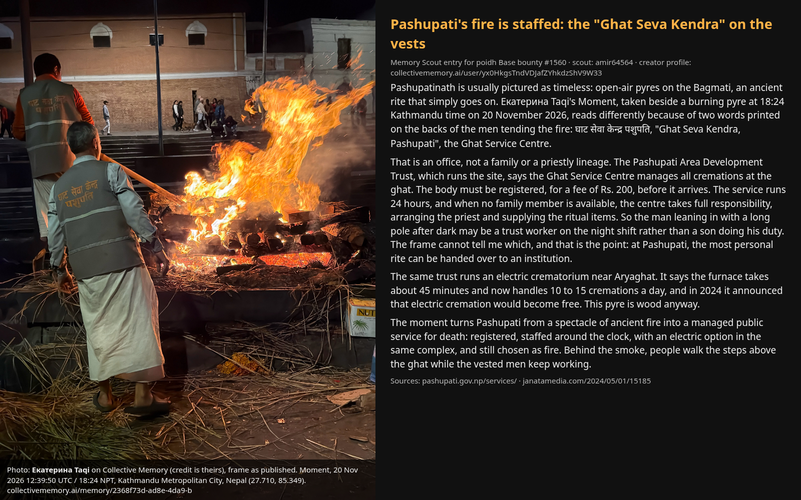

# Pashupati's fire is staffed: the "Ghat Seva Kendra" printed on the vests at the pyre

Memory Scout entry for [poidh Base bounty #1560](https://poidh.xyz/base/bounty/1560).

Collective Memory: https://www.collectivememory.ai/memory/2368f73d-ad8e-4da9-b/a-nocturnal-low-angle-shot-depicts-a-cremation-pyre-ablaze-w

Original creator: Екатерина Taqi (credit is theirs), https://www.collectivememory.ai/user/yx0HkgsTndVDJafZYhkdzShV9W33

Place: Pashupati cremation ghats, Kathmandu Metropolitan City, Nepal (memory geo 27.710, 85.349). A place I have never been.

Capture: photo "Moment", record timestamp 2026-11-20 12:39:50 UTC (18:24:50 Nepal time, UTC+5:45). Verification: the original JPEG (iPhone 17 Pro, back camera) carries DateTimeOriginal 2026:11:20 18:24:48.53 local, 1.5 s before the memory record, and is part of a same-place sequence by the creator (12:40:24, 12:41:28, 12:41:53 UTC): a live in-app capture, not a camera-roll upload. The vest text (घाट सेवा केन्द्र पशुपति) is legible in the original frame.

Pashupatinath is usually pictured as timeless: open-air pyres on the Bagmati, an ancient rite that simply goes on. Екатерина Taqi's Moment, taken beside a burning pyre at 18:24 Kathmandu time on 20 November 2026, reads differently because of two words printed on the backs of the men tending the fire: घाट सेवा केन्द्र पशुपति, "Ghat Seva Kendra, Pashupati", the Ghat Service Centre.

That is an office, not a family or a priestly lineage. The Pashupati Area Development Trust, which runs the site, says the Ghat Service Centre manages all cremations at the ghat. The body must be registered, for a fee of Rs. 200, before it arrives. The service runs 24 hours, and when no family member is available, the centre takes full responsibility, arranging the priest and supplying the ritual items. So the man leaning in with a long pole after dark may be a trust worker on the night shift rather than a son doing his duty. The frame cannot tell me which, and that is the point: at Pashupati, the most personal rite can be handed over to an institution.

The same trust runs an electric crematorium near Aryaghat. It says the furnace takes about 45 minutes and now handles 10 to 15 cremations a day, and in 2024 it announced that electric cremation would become free. This pyre is wood anyway.

The moment turns Pashupati from a spectacle of ancient fire into a managed public service for death: registered, staffed around the clock, with an electric option in the same complex, and still chosen as fire. Behind the smoke, people walk the steps above the ghat while the vested men keep working.

Sources: https://www.pashupati.gov.np/services/ (PADT: Ghat Service Center, Rs. 200 registration, 24-hour, takes full responsibility if family unavailable; electric crematorium ~45 min, 10-15/day) ; https://janatamedia.com/2024/05/01/15185 (2024 announcement: electric cremation at Aryaghat to be free from 1 Shrawan)

Card (frame credited to Екатерина Taqi, CC BY 4.0 as shown on the memory page): card.png in this repository
